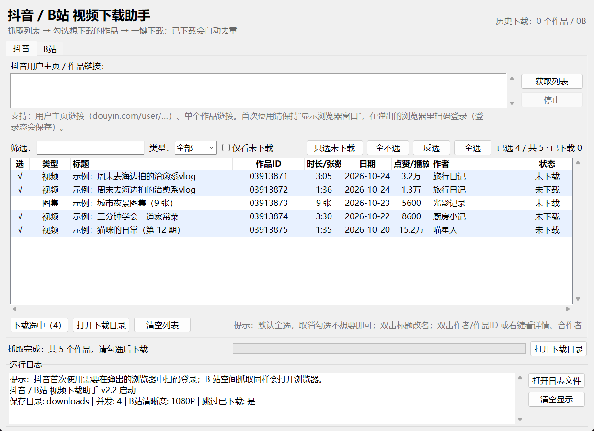
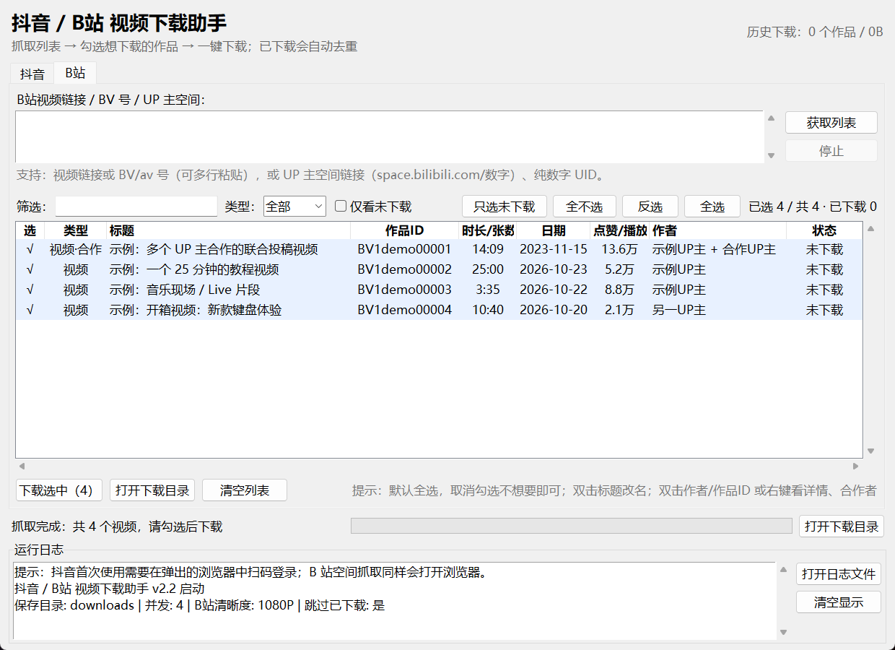

# 抖音 / B站 视频下载助手 v2.4

> A desktop GUI downloader for Douyin & Bilibili videos / image albums.  
> 抓取列表 → 勾选作品 → 下载；自动去重、自动合并 B站音视频。Windows / Python 3.10+。
> **非官方工具，仅供个人学习研究使用；使用前请阅读 [DISCLAIMER.md](DISCLAIMER.md)。**

把原来分散的抖音、B站下载脚本整理成了一个**带图形界面**的小工具：

> **抓取列表 → 勾选想下载的作品 → 一键下载**

不用再改代码里的链接，也不用全量下载；列表里默认全选，**取消勾选不想下载的作品即可**。
没有标题的作品可以**手动改名**，已下载的作品还能同步改文件名。





> 截图中为界面演示数据，不是真实账号内容。

---

## 1. 这个版本解决了什么

| 旧脚本的问题 | 新工具的改进 |
|---|---|
| 链接写在源码里，每次要改代码 | 界面里粘贴链接即可 |
| 没有选择界面，只能全部下载 | 结果列表可勾选、可筛选、可全选/反选/只选未下载 |
| 抖音视频与图集要跑不同脚本 | 自动识别视频/图集，同一个列表里勾选 |
| B站要按 F12 手动复制两条 m4s 地址 | 粘贴视频链接/BV 号/UP 主空间即可自动解析、下载、合并 |
| 重复运行会重复下载 | SQLite 记录已下载，自动跳过；也可在设置里清空记录 |
| Cookie 要手动复制粘贴 | 自动复用浏览器登录态（也支持手动填 Cookie） |
| 出错时只能看控制台 | 界面日志 + 日志文件 + 每项下载进度，可随时停止 |
| 有些作品没有标题，只能叫“无标题作品_ID” | 双击标题列（或按 F2 / 右键）手动改名；已下载的可同步重命名文件 |
| 同名作品/联合投稿分不清是谁的 | 列表新增“作品ID”列；B站联合投稿显示所有合作者，双击作者或右键“查看详情/合作者” |

---

## 2. 环境准备

- **Windows**（本工具在 Windows 10/11 上验证）
- **Python 3.10+**，推荐 3.13。本项目在 **Anaconda Python 3.13.9** 下完整验证
- **Google Chrome**：抓取抖音/B站列表时由 DrissionPage 自动启动，无需手动装驱动
- Python 依赖（`tkinter` 是 Python 自带的，不需要装）：

```bash
pip install -r requirements.txt
```

> 用 PyCharm 的话，请把项目解释器切换为已安装上述依赖的 Python
> （选择你安装依赖时用的那个 Python 即可，不要用系统 PATH 里没有依赖的解释器）。

---

## 3. 启动方式

| 方式 | 操作 |
|---|---|
| 双击启动（推荐） | 双击 `start.bat`，脚本会自动寻找装有依赖的 Python |
| PyCharm / 命令行 | `python app.py` |
| 命令行交互模式 | `python app.py --cli`（或 `start.bat --cli`） |

首次使用抖音或 B 站空间抓取时会打开 Chrome 窗口：

1. 保持设置里的“抓取列表时显示浏览器窗口”为勾选状态；
2. 在弹出的浏览器里扫码登录抖音 / B站；
3. 登录状态会保存在 `data/browser_profile/`，以后不用重复登录。

---

## 4. 使用步骤

### 4.1 抖音

1. 打开抖音网页版，进入目标用户主页，复制地址栏链接；
   也支持单个视频/图文作品链接（含分享短链）。
2. 粘贴到“抖音用户主页 / 作品链接”输入框，点 **获取列表**。
3. 抓取完成后，列表默认全选：
   - **取消勾选**不想下载的作品（单击“选”列的 √ 即可）；
   - 用“类型 / 关键词 / 仅看未下载”筛选；
   - 或用“全选 / 全不选 / 反选 / 只选未下载”。
   - **没有标题的作品**：双击“标题”列（或选中后按 F2、右键“重命名标题…”）输入新名字；
     已下载的作品会询问是否同时重命名本地文件。改完名字再下载，文件名也会使用新标题。
   - **同名作品**：看“作品ID”列区分（抖音显示 aweme_id 后 8 位，B站显示 BV 号）；
     下载文件名里也带这个唯一 ID，同一个名字也不会互相覆盖。
   - **想确认是谁的视频/有没有合作者**：双击“作者”或“作品ID”列，或右键“查看详情 / 合作者…”。
4. 点 **下载选中**，确认后开始并发下载。
   - 视频：`downloads/抖音/作者/视频/日期_标题_awemeId.mp4`
   - 图集：`downloads/抖音/作者/图集/日期_标题_awemeId/01.jpg…`

> 未登录时抖音只展示少量作品甚至 0 个，界面会给出提示；在打开的浏览器里扫码登录后重新点“获取列表”即可。

### 4.2 B站

B站标签页支持两种输入，程序会自动识别：

1. **视频链接 / BV 号 / av 号**：可以一次粘贴多条（每行一条），也可以直接粘贴分享文案（自动提取 BV 号）。
2. **UP 主空间**：粘贴 `https://space.bilibili.com/数字/video`、带 `mid=` 的链接，或直接输入纯数字 UID；程序会打开空间页并自动滚动抓取投稿列表（默认最多 600 条）。

抓取后同样在列表里勾选，点“下载选中”：

- B站的**联合投稿/合作视频**会在“类型”列显示“视频·合作”，作者列显示主 UP + 合作者；
  空间列表里带 `is_union_video` 标记的会自动补全合作者名单（最多补 40 条，其余可在详情里单独读取）；
  文件按**投稿人（主 UP）**归档，合作者不会丢，详情里能看到完整名单；

- 自动获取 DASH 视频流 + 音频流，用 ffmpeg **无转码合并**成 mp4；
- **多 P 视频（合集/课程）在“获取列表”时就按集展开**：94P 的视频会列出 94 行，类型列显示
  `视频·P3/94`，标题以集号+小标题开头（如 `P3 Unit1（2） - 课程名`），只勾选想下的几集即可；
  文件名仍是旧版格式 `日期_视频标题（94P）_BV号_P3.mp4`，以前整段下过的分集会被识别为已下载；
- UP 主空间列表不逐条查分 P（省接口），需要时勾选后点“展开选中为分P”，或右键单条“展开为分P…”；
- **清晰度（为什么下载比网页糊）**：B 站按登录态发放清晰度，未登录时 `playurl` 只返回 360P/480P，
  而网页版能看 1080P 是因为浏览器里有你的登录 Cookie。程序里点 B 站标签页的 **“登录B站”**，
  在弹出的浏览器里扫码登录后会把登录态写进配置，之后下载就能拿到 1080P/1080P60/4K；
  也可以在“设置”里手动粘贴 B站 Cookie（浏览器 F12 → Network → 任一请求的 Cookie 复制 `SESSDATA=…` 那段）；
- 清晰度上限在“设置 → B站清晰度”里选：默认 **最高可用（4K/1080P60）**，实际会取账号权限内不超过该值的最好流，
  日志会打印真实清晰度，例如 `清晰度: 1080P60（1920×1080@60fps）`。

### 4.3 设置

菜单 **设置 → 参数设置…** 可修改：

- 保存目录（默认项目下的 `downloads/`）
- 并发下载数（默认 4）
- 抖音/B站最多抓取数量
- B站清晰度（1080P / 720P / 480P）
- 下载间隔、是否跳过已下载、抓取时是否显示浏览器窗口
- 抖音/B站 Cookie（可选）
- 清空下载记录（只清记录，不删已下载文件）

---

## 5. 目录结构

```
python-douyin_desktop/
├─ app.py                    # 程序入口
├─ start.bat                 # 双击启动脚本（自动找可用 Python）
├─ requirements.txt
├─ README.md
├─ pytest.ini
├─ config.json               # 保存设置后自动生成
├─ media_crawler/            # 核心代码
│  ├─ config.py              # 配置与路径
│  ├─ models.py              # 统一作品模型
│  ├─ storage.py             # SQLite 去重记录
│  ├─ net.py                 # 下载/重试/WBI 基础
│  ├─ browser.py             # DrissionPage 浏览器会话
│  ├─ douyin.py              # 抖音抓取 + 下载
│  ├─ bilibili.py            # B站解析/取流/合并
│  ├─ downloader.py          # 并发下载调度
│  ├─ cli.py                 # 命令行交互模式
│  └─ ui/                    # tkinter 图形界面
├─ tests/                    # pytest 用例
├─ docs/                     # 界面截图
├─ data/                     # 运行后生成：日志、登录态、数据库、临时文件
└─ downloads/                # 下载内容（按平台/作者分类）
```

> 整个 `python-douyin_desktop` 文件夹可以直接复制或移动到其他目录/电脑。
> 设置里的保存目录会以相对路径记录（`downloads`），移动后仍然有效；
> 如果希望连登录状态和下载记录一起搬走，请连 `data/` 文件夹一起复制。

---

## 6. 和旧脚本的对应关系

新工具是从原来的爬虫项目整理重写的，**没有改动原项目里的文件**。对照如下：

| 旧文件 | 原用途 | 在新工具中的位置 |
|---|---|---|
| `all_douyin_ai.py` | 抖音视频+图集最终版 | 抖音标签页（视频/图集自动识别） |
| `re_douyin_ai.py` | 抖音最终版（测试/迭代） | 已合并，可删除 |
| `images_douyin.py` | 只下图集 | 已合并，可删除 |
| `re_douyin.py` | 最初版测试 | 已合并，可删除 |
| `re_bilbil.py` | 手动粘贴两条 m4s 地址合并 | B站标签页（自动解析链接/UP主列表 + 自动合并） |

确认新工具可用后，旧脚本可以自行备份并删除。

---

## 7. 常见问题

**Q1：抖音只抓到 20 个甚至 0 个？**
未登录被限制。保持“显示浏览器窗口”勾选，在弹出的浏览器里扫码登录，再点“获取列表”。

**Q2：Chrome 启动失败 / 提示连接失败？**
1) 关闭本工具之前留下的 Chrome 窗口；2) 确认系统已安装 Google Chrome；3) 确认没有其他程序占用 9222 端口；4) 仍不行就重启电脑再试。

**Q3：B站空间抓不全或提示风控？**
先在该浏览器窗口里登录 B站，稍等片刻再重试；B站对未登录/高频请求有风控。

**Q4：B站下载没有声音/合并失败？**
确认已安装 `imageio-ffmpeg`（`pip install imageio-ffmpeg`）；界面日志里会打印具体的 ffmpeg 错误。

**Q5：B站下载清晰度只有 480P / 比网页版糊？**
这是没登录导致的，不是合并或 ffmpeg 的问题：未登录请求 `playurl` 时 B 站返回的
`accept_quality` 只有 `[32, 16]`（480P/360P），接口根本不给 1080P 的流。
两种解决办法（任选其一）：
1) 在 **B 站标签页点“登录B站”** → 弹出的浏览器里扫码登录 → 程序自动保存登录 Cookie；
2) **设置 → B站 Cookie** 里粘贴浏览器 F12 复制的 Cookie（含非空 `SESSDATA`）。

登录后把“B站清晰度”设成 **最高可用（4K/1080P60）**（默认值），日志会显示实际拿到的清晰度；
同一视频 4K 需要该视频本身有 4K 且账号有权限，1080P60 同理，没有就自动降级到最高可用。

**Q6：重复下载怎么办？**
默认“跳过已下载”，记录在 `data/media.db`。想重新下载可在设置里清空下载记录，或取消勾选“跳过已下载”。

**Q7：下载很慢？**
默认并发 4、带下载间隔以降低风控风险；可在设置里适当调大并发、调小间隔，但不建议过于激进。

**Q8：文件名里的日期/ID 是什么？**
日期便于按时间排序，`awemeId`/`BV号` 用于避免同名冲突和定位原作品。

**Q9：没有标题的作品怎么改名？**
在结果列表里**双击“标题”列**（或选中后按 **F2**，或右键选择“重命名标题…”），输入新名字即可。
如果这个作品已经下载过，程序会问你“是否同时重命名文件”；选择“是”会一起改文件名并更新下载记录。
改过的名字会保存在 `data/media.db` 的 `custom_titles` 表里，下次重新抓取仍然显示你改的名字；
改完再下载的作品，会直接用新标题生成文件名。

**Q10：下载记录是怎么判断“已下载”的？存在哪里？**
记录保存在 `data/media.db`（SQLite 数据库）的 `downloads` 表里。
每个作品用平台 + 作品 ID 作为唯一键：抖音是 `douyin:aweme_id`，B站是 `bilibili:BV号`；
下载成功后写入标题、作者、文件路径、大小和时间。再次抓取列表时，程序会对照数据库，
并检查记录里的文件是否还在，文件还在就显示“已下载”并默认跳过；文件被删了则自动恢复为“未下载”。
菜单 **设置 → 清空下载记录** 只清记录，不会删除已经下载的文件。

**Q11：能把整个工具移动到其他文件夹吗？**
可以。把整个 `python-douyin_desktop` 文件夹复制/移动即可，代码和配置都用相对路径：
- 只搬代码：新位置第一次运行会重新生成 `data/`（登录状态、下载记录需要重新来），`downloads/` 里的旧文件留在原处；
- 连 `data/` 一起搬：登录状态、下载记录都会跟着走（Chrome 用户资料偶尔需要重新登录一次）；
- 下载目录想改到别的盘：在“设置”里选择新目录即可，外部目录会保存为绝对路径。

**Q12：双击 start.bat 闪退/提示 `FileNotFoundError: 'X:\\'`？**
通常是 `config.json` 里配置的保存目录（例如 `X:\Movies\download`）所在的移动硬盘/网络盘没有连接。
程序现在会自动回退到项目内的 `downloads/` 并继续启动，同时会在日志和状态栏提示；
磁盘没连接时也不会误删你的下载记录，插回后记录仍然有效。
解决办法：把磁盘插回来后重启；或者打开“设置”换一个可用的保存目录。

> 如果希望恢复原来的 `X:` 盘，插回后直接重新启动即可；配置文件里的路径没有被自动改写。

**Q13：同名作品、多个博主合作的视频怎么区分？**
1) 列表新增“作品ID”列：抖音是 aweme_id 后 8 位，B站是 BV 号；筛选框也能直接搜作品ID或合作者；
   下载文件名里也带唯一 ID，所以同名不会互相覆盖；
2) B站联合投稿：类型列显示“视频·合作”，作者列显示“主UP + 合作者”；双击“作者”或“作品ID”列（或右键“查看详情 / 合作者…”）
   会调用 B站接口读取 staff 名单，能看到每个人在视频里的角色（UP主/参演/编剧等）；
3) 下载后的文件按“投稿人”归档；如果你是冲着某个合作者下载的，可以在详情里确认后再改名/移动。
4) 抖音的共创字段如果接口没有返回，详情里会提示“抖音接口未提供合作者名单”，可以点“在浏览器中打开”查看。

---

## 8. 测试

```bash
python -m pytest
```

当前共 **69 个用例**，覆盖：抖音 JSON 解析/标题回退/共创字段、B站 BV/WBI/分P/取流选择、B站多P列表级展开
（每P一条、`P3/94` 标记、`_P3.mp4` 文件名、列表原位替换、已下载标记）、
清晰度上限/4K/60fps 流选择与 `fnval=4048` 取流、登录态判断、B站联合投稿 staff 解析、
命令行选择表达式、SQLite 去重、重命名文件、自定义标题持久化、配置相对路径、界面列表组件与主窗口冒烟测试。

已完成的真实链路验证：

- B站视频 `BV1demo00001`：链接解析 → WBI 取流（未登录 480P）→ 下载视频+音频 → ffmpeg 合并，mp4 成功；第二次运行正确跳过（去重）。
- B站 UP 主空间 `mid=2`：浏览器自动滚动抓到 40 条投稿并解析成功。
- B站 94P 合集 `BV1demo00002`：获取列表直接展开成 94 个条目（`视频·P1/94` … `视频·P94/94`），标题带集号与小标题，文件名 `2026-09-07_…（94P）_BV1demo00002_P3.mp4`。
- 抖音：未登录状态下返回 0 条并给出登录提示；登录后的完整抓取需要你在本机首次运行并扫码验证。

---

## 9. 发布到 GitHub（隐私须知）

这个项目已经按“可以公开分享”的方式整理过：`data/`、`downloads/`、`config.json` 都写在 `.gitignore` 里，
**不会被 git 提交**。但发布前仍请按下面的步骤确认一遍。

### 9.1 哪些内容绝对不能上传

| 路径 | 里面有什么 |
|---|---|
| `data/browser_profile/` | Chrome 登录状态，含抖音/B站 Cookie（SESSDATA 等），泄露后别人可登录你的账号 |
| `data/media.db` | 你的下载记录、作者、标题、本地文件路径（你已下载 400 条记录） |
| `data/logs/` | 运行日志，含本机用户名、盘符路径、抓取过的作者名 |
| `config.json` | 保存目录（例如 `X:\Movies\download`）、Cookie（如填过） |
| `downloads/` | 实际下载的视频/图片 |

`.gitignore` 已默认忽略以上全部内容。**不要用 GitHub 网页“拖拽整个文件夹”上传**，因为网页上传不会读取 `.gitignore`；
请用 Git 命令上传。

### 9.2 推荐发布步骤

```bash
cd python-douyin_desktop
git init -b main
git add -A
git status --short          # 检查列表里不应出现 data/、downloads/、config.json、*.log
git commit -m "init: 抖音/B站视频下载助手 v2.2"
# 在 GitHub 网页新建空仓库后：
git remote add origin https://github.com/<你的用户名>/<仓库名>.git
git push -u origin main
```

发布前可以再确认一次：

```bash
git check-ignore -v data config.json downloads
```

### 9.3 如果已经误传了

1. 立即把文件从 Git 索引移除（但保留本地文件）：
   ```bash
   git rm --cached -r data downloads config.json
   git commit -m "remove private local data"
   git push
   ```
2. **历史提交里仍然能翻到旧内容**，需要 `git filter-repo` 或 BFG 清理历史；
3. 如果你的 Cookie 曾出现在公开仓库：立刻在抖音/B站退出登录、修改密码，并删除 `data/browser_profile/` 重新扫码。

### 9.4 提交邮箱也会公开

`git config user.email` 会写进每条提交记录。如果不想公开 QQ/真实邮箱，可以在 GitHub 设置里使用
`<用户名>@users.noreply.github.com` 作为提交邮箱，或在本仓库执行：

```bash
git config user.email "<你的GitHub用户名>@users.noreply.github.com"
```

### 9.5 仓库信息建议

- 仓库名：`douyin-bilibili-downloader`
- 描述：`抖音/B站视频下载桌面工具：抓取列表、勾选下载、自动去重、B站音视频合并`
- Topics：`douyin` `bilibili` `downloader` `tkinter` `drissionpage` `python`
- License：MIT（见 `LICENSE`）

---

## 10. 合规与免责声明

- 本工具仅供**个人学习、技术研究、本地收藏**使用，详见 [DISCLAIMER.md](DISCLAIMER.md)；
- 本项目与抖音、字节跳动、哔哩哔哩无隶属或合作关系，平台名称仅作描述性使用；
- 请遵守抖音/B站用户协议，控制请求频率，不要用于批量采集、商业用途或二次传播；
- 不要尝试破解平台加密、绕过验证码或利用漏洞；
- 下载内容的版权归原作者所有，请尊重原创。

---

## 11. 更新日志

| 日期 | 版本 | 说明 |
|---|---|---|
| 2026-10-22 | v2.0 | 合并抖音/B站脚本为统一桌面工具；新增列表勾选、筛选、去重、自动合并、设置页、命令行模式 |
| 2026-10-22 | v2.1 | 新增作品重命名（可同步改已下载文件）、无标题作品自动标题回退、保存目录相对路径（整个文件夹可移动） |
| 2026-10-23 | v2.2 | 新增“作品ID”列、B站联合投稿合作者解析/补全、作品详情对话框；同名作品可区分且文件名带唯一 ID |
| 2026-11-02 | v2.3 | B站多P视频在“获取列表”阶段就按集展开（类型列显示 `视频·P3/94`，每集单独勾选）；空间列表可右键/按钮“展开为分P”；已下载的旧文件会按 `_P3.mp4` 自动标记为已下载 |
| 2026-11-08 | v2.4 | 修复“B站下载比网页糊”：清晰度上限默认改为最高可用（4K/1080P60），取流改用 `fnval=4048` 全特性、同清晰度优先 AVC；新增“登录B站”按钮（浏览器扫码登录→保存 Cookie）与下载前未登录提示；日志打印实际清晰度 |
